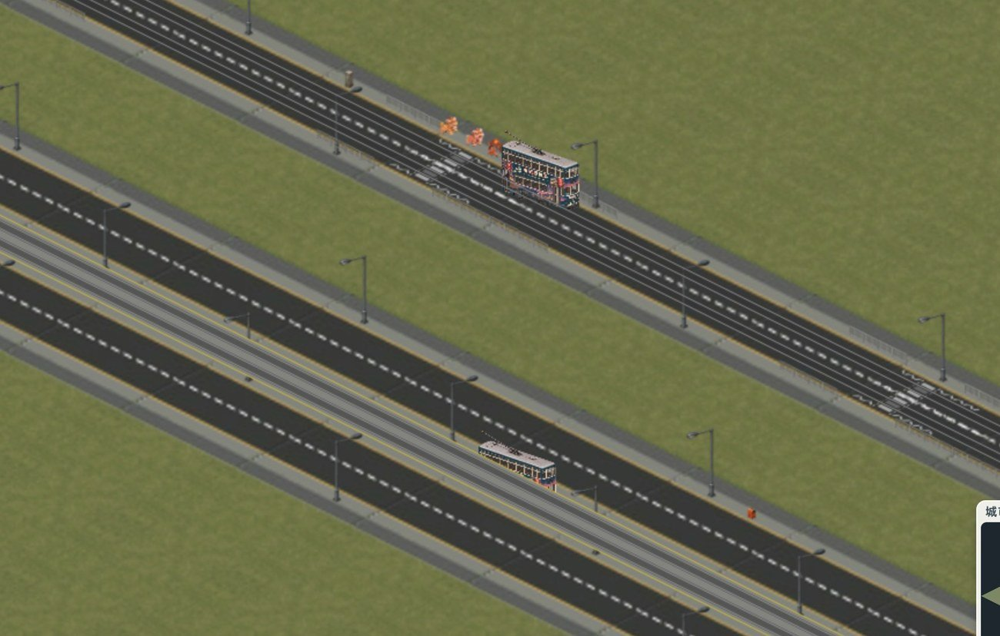
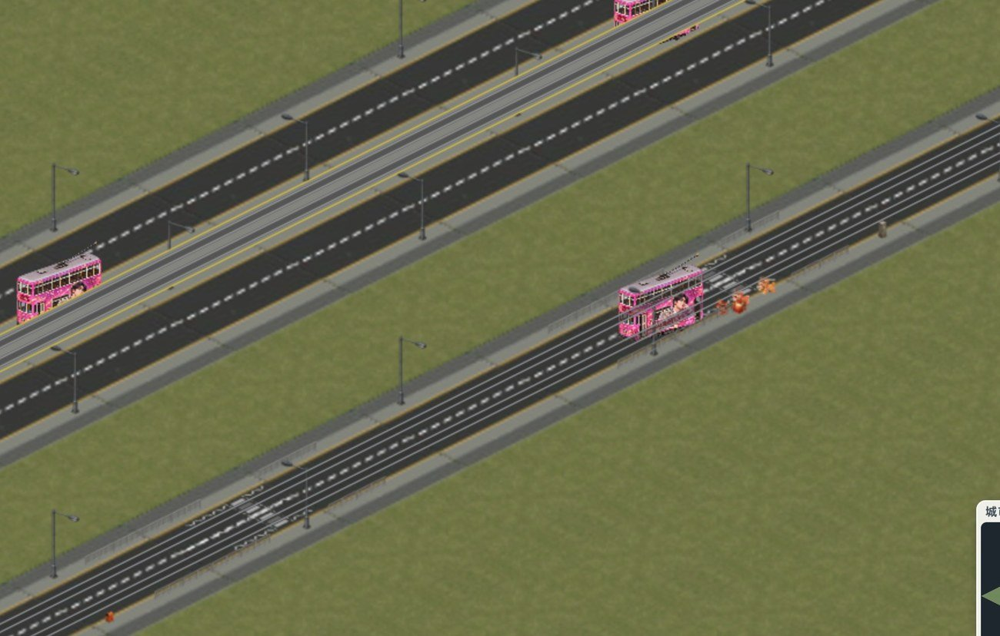
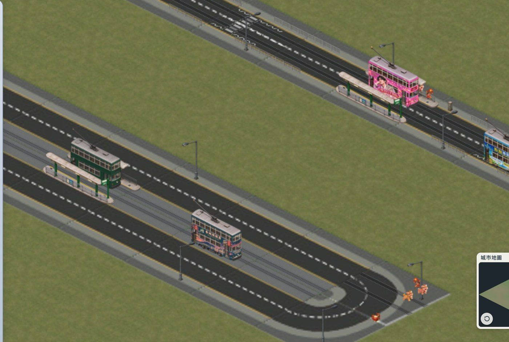
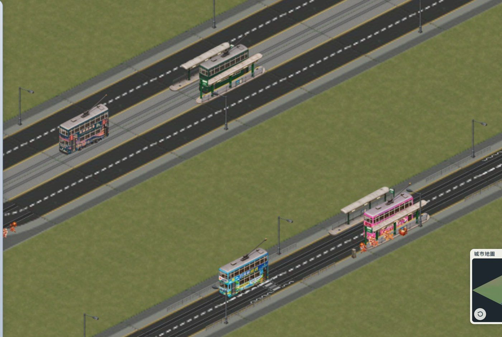

# 電車 — 設計 v0.1

日期：2026-11-08。狀態：Norton 已決定（§9），開始做第一期（路軌）。

## 1. 目標

運輸公司第四種交通工具：叮叮。電車軌道鋪喺**現有嘅馬路**上面，唔另外起路：

- **窄路**（一格寬、雙向）：喺原有兩條行車線入面各加一條同向路軌，電車同車輛共用行車線。
- **雙線**（兩條平行馬路自動合成嘅雙程分隔道路，`getRoadCarriagewayBand`）：中間兩邊嘅
  路肩（行人路）變成電車專用路，好似軒尼詩道、德輔道中咁，電車喺馬路中間行。
- 暫時唔畫架空電線（避免畫面太亂）。電車站模型之後再加，好似巴士站咁擺。

（遊戲入面嘅示意：灰色電車路、路軌、電車都係臨時用 Graphics 畫出嚟，唔係最後美術。）

## 2. 路軌

### 2.1 鋪設

- **電車路軌工具**（運輸模式「電車」分頁）：喺馬路上拖拉，好似地鐵路軌工具咁，沿住路逐格鋪。
  只可以鋪喺馬路格；唔可以鋪喺橋、斜路、隧道口（之後再算）。
- 每格記住路軌連去邊幾邊（同地鐵一樣用 TrackBits：直、轉角、T 字、十字），
  `tram.tracks["row:col"] = mask`。
- 拆路會連路軌一齊拆；推土機可以只拆路軌（路留低）。
- **費用**：每格 $120（巴士路線唔使錢、地鐵地面路軌每格 $200；電車路軌嵌入路面）。

### 2.2 窄路

- 兩條路軌，各自喺一條行車線中間（traffic 嘅 `single` 車線位置，離路中 0.12 格，約 2.4 米），
  靠左行（香港行車方向）。
- 轉角：路軌跟住路嘅彎位轉（四分一圓弧）；T 字、十字路口只畫電車實際行經嘅方向。

### 2.3 雙線

- 一條雙線兩格寬（每格單向）；兩格中間相鄰嘅兩條行人路變成**電車專用路**：
  灰色混凝土路面、兩邊黃線，每邊行人路一條路軌（離中線約 1.6 米，兩軌相距約 3.2 米，同港島電車差唔多）。
- 每條路軌跟旁邊嗰條車路同方向行（靠左）。車輛照用原本兩條行車線，唔受影響。
- 三格或以上嘅闊路：用最中間嗰兩格之間嘅行人路；單數闊度中間嗰格（雙向共用線）唔鋪。
- 有電車路嘅雙線，中間只留電車路軌同（之後嘅）電車站：路燈唔放喺中間（`tram.js` `isTramReservationSide`，
  `street-lamps.js` 嘅 `skipSideAt`）；欄杆同街道雜物本身已經唔放喺兩邊都係馬路嘅路肩。

### 2.4 窄路同雙線相接

- 由窄路（路軌喺行車線）入雙線（路軌喺中間電車路）：喺雙線第一格用一個「過渡件」，
  兩條路軌由行車線斜斜移入中間，好似軒尼詩道入莊士敦道嗰種收窄位。

### 2.5 美術

- 路軌疊喺路面上面，另一層（同路面標線一樣），唔改原有路面圖：
  - 窄路：直、轉角、T、十字、尾站，各兩個方向；
  - 雙線：中間電車路（直、過渡件、路口穿過）。
- 用程式畫（同 `prepare-railway-track-assets.py` 一樣）：鋼軌嵌入路面、路軌兩邊一條淺灰混凝土邊。
  夜晚跟路面一齊暗。
- 512×256，跟路面圖一樣大小同錨點。

## 3. 電車路線

- 一條路線 = 路軌上嘅一串站（之後有電車站模型；未有站之前，用兩個尾站）。
  好似地鐵地面綫咁，沿路軌由一個站行去下一個站（`findSurfacePath` 嗰種搵路）。
- **尾站**：電車喺尾站掉頭（反方向開返出去）。香港電車係單頭車，用迴圈掉頭（例如筲箕灣、
  堅尼地城）；我哋嘅電車兩頭外形差唔多，第一期用直接掉頭，之後可以加迴圈。
- 每條路線最多 20 個站；全公司最多 6 條路線。名同顏色好似巴士路線咁設定。

## 4. 電車

| | |
|---|---|
| 售價 | $1,200（雙層巴士約 $280，地鐵列車 $5,000） |
| 載客 | 115 人一架 |
| 速度 | 每顯示分鐘 1 格（巴士 1.33，電車慢啲） |
| 停站 | 每站半分鐘 |
| 保養 | 每月 $40，加每格行駛成本 |
| 每線上限 | 12 架 |
| 車費 | 劃一 $0.3（巴士按距離），平但載客多 |

**車身大小**：Norton（2026-11-08）：巴士約 12 米、電車約 9 米 —— 電車喺畫面上係巴士嘅 80%（`tram-art.js` 嘅 `scale`）。
每張圖記住車底中心（腳點）：由車輪同車頭保險槓最低點，以 0.5 斜率搵出近地角，再取車身範圍嘅中心，令電車坐喺路軌上。

**美術**（`Models/tramways/`）：

- `tramOrigin1`、`tramOrigin2`：綠色標準車身，車頭向右下／左下（即地鐵嘅 fall、rise 視角）。
- `tramStyle01`（香城模擬器）、`tramStyle02`（Lan 生日快樂）、`tramStyle03`（日夜都繽週）：廣告車身。
- 馬路只有兩個方向，所以兩個視角已經夠：同一條軸線上兩個方向用同一張圖（兩頭外形接近）。
  轉彎時喺路口換圖。
- **已做（2026-11-08）**：修正 isometric 比例，以上層窗框（氣窗架）做 reference。原圖鏡頭低啲（地面線斜率約 ±0.34，
  即約 20 度俯角；遊戲係 0.5，30 度）。鏡頭升高時橫向位置唔變、車頂（水平面）睇深 0.5/0.34 ≈ 1.47 倍、
  車身（垂直面）矮 cos30/cos20 ≈ 0.92 倍；所以唔可以好似樓宇咁成張圖一個 skew 加 x:y 比例（咁會令車身拉高
  1.47 倍，睇落「擠扁」）。做法：逐列以車頂近邊（車頂同車身交界）為準，下面（車身、車頭）乘 0.92，上面（車頂）
  乘 1.47，近邊由轉角起兩邊各 0.5 斜，左右唔郁。結果上層窗框斜率 0.498–0.500。
  `scripts/prepare-tram-assets.py` → `Models/tramways/squared/`（原圖保留）。原圖背景本身已經係透明。
  `tramOrigin2` 係 `tramOrigin1` 嘅鏡像。
- 要做：每款都要 fall 同 rise 兩個視角（廣告車而家每款得一個，可以由已有嗰張鏡像，但鏡像後字會反，
  所以廣告車要請 Norton 補圖，或者廣告車只用喺有圖嘅方向）；夜晚窗燈（`_lit`，同地鐵一樣嘅做法）；
  車頭燈、尾燈。
- 每架電車隨機一款車身（標準綠色多啲，廣告車少啲），好似香港咁。
- **夜晚燈（Norton 2026-11-08）**：好似香港電車 —— 由前面望，車頭下面正中一個大車頭燈；由後面望，車尾下面兩邊兩個紅燈。
  燈位由原圖讀出（`scripts/prepare-tram-assets.py` `TRAM_LAMPS`），跟住修正同鏡像搬去遊戲貼圖（`tram-art.js` `head`、`tails`）；
  用路面車輛嘅燈光（`traffic-visuals.js`），車頭燈係巴士一個燈嘅 1.35 倍。電車向住圖入面車頭嗰邊行就見車頭，相反就見車尾。
- **車站燈**：上蓋下面三支光管著燈，有光暈，月台地面有一片光（`tram_stop_*_lit.png`，同樓宇燈一齊著）。

## 5. 行車

- **窄路**：電車同車輛共用行車線。而家路面車輛唔會跟車（會穿過前面嘅車），電車大過車，
  穿過會好明顯 —— 見 §9 問題 3。
- **雙線**：電車喺中間專用路行，同車輛冇衝突；過路口時直行。
- 同一條路軌上嘅電車互相保持距離（用地鐵嘅 `resolveSurfaceBlocking` 做法）。

## 5b. 電車站配置（2026-11-08）

量度路面圖：一格 20 米；車路 10 米（兩條行車線，線中心離路中 ±2.4 米），兩邊行人路各 5 米。
雙線嘅電車專用路 = 兩條中間行人路 = 10 米闊，兩條路軌離中線 ±1.6 米。

- **一個電車站 = 一格路上嘅一對月台**（每個方向一個），用「電車站」工具撳一格有電車路軌嘅直路
  （唔可以係路口、巴士站格）。月台長一格（20 米，香港電車站大約 20–25 米）。
- **雙線**：兩個月台都喺中間電車專用路入面，各自喺自己條路軌嘅外側（月台中心離中線約 3.9 米），
  上落客嗰邊（黃線）向住路軌，欄杆向住行車線 —— 好似軒尼詩道咁。
- **窄路**：兩個月台喺路邊，各自喺自己行車線嘅左邊（靠左行），月台中心喺行人路邊（離路中 5 米），
  上落客嗰邊向住路軌；嗰段行人路嘅欄杆同街道雜物讓位（同巴士站一樣）。
- **用邊張圖**：上落客嗰邊向住鏡頭 → `tramStopFront`；背住鏡頭 → `tramStopBack`。月台長邊喺畫面向右下
  就用原圖，向右上就用鏡像（字會反，同廣告電車一樣，簡單為主）。地圖轉方向時自動揀返。
- **斑馬線**（Norton：車站旁邊通常有斑馬線）：車站隔籬嗰格（沿路，先揀車行方向前面嗰格，唔得就後面嗰格）
  畫斑馬線，雙線就兩條車路一齊畫，行人由行人路過去月台。嗰格要係普通直路（唔係路口、巴士站）；
  兩邊都唔得就唔畫（附近路口有斑馬線）。
- **模型闊度（Norton 2026-11-08：用窄嗰張）**：兩張圖原本唔係同一個月台，`tramStopBack` 闊 1.53 倍；以
  `tramStopFront` 為準，背面圖嘅地面（月台、上蓋、柱位）以欄杆為軸收窄到 0.655 倍（高度唔變）。量度後月台闊係
  長度嘅 0.112 —— 長一格（20 米）就係 2.24 米闊，上蓋約 3 米，同香港電車站差唔多。`tram-art.js` 嘅 `stop_*`
  記住月台中心（腳點）同令佢長一格嘅比例。
- **位置（月台中心離中線）**：雙線 ±0.20 格（4.0 米：上落客邊喺電車外面 0.1 米，外邊到電車專用路邊）；
  窄路 ±0.32 格（6.4 米：成個月台喺行人路上，好似巴士站咁，唔踩路邊黃線，巴士同其他車照過到 —— Norton）。
  `tram.js` `TRAM_STOP_OFFSET`。
- **費用**：$800 一個站（兩個月台），每月保養 $20；覆蓋 4 格。
- **拆**：推土機撳月台嗰格拆車站；有路線停嘅站要先由路線移走（同巴士站一樣）。

## 6. 乘客同收入

- 電車站覆蓋 4 格（巴士站 5 格，電車站密）；短途乘客多。
- 用巴士嘅乘客模型（站附近住宅同工作地點），但電車站之間距離短，所以每程收入少、人多。
- 月結入運輸公司（同巴士、地鐵共用資金同報表）。

## 7. 分期

1. **路軌**：工具、資料、美術（窄路同雙線，含轉角、路口、過渡件）、拆除。
2. **電車同路線**：電車圖（去背、兩個視角、夜晚燈光）、尾站掉頭、沿路軌行、同軌保持距離。
3. **電車站**：等 Norton 嘅電車站模型，好似巴士站咁擺（窄路喺路邊；雙線喺中間電車路做安全島）。
4. **乘客同收入**、運輸模式路線表、香城討論區通車新聞。
5. （之後）迴圈尾站、架空電線、電車同車輛嘅跟車。

## 8. 唔做（暫時）

架空電線、電車廠（電車直接喺尾站出現，好似地鐵列車咁）、山坡同橋上嘅路軌、輕鐵。

## 9. Norton 嘅決定（2026-11-08）

1. **鋪路軌**：(A) 先用路軌工具鋪軌，再喺軌上開路線（同地鐵一樣，幾條線可以共用路軌）。
2. **尾站**：先跟地鐵地面綫嘅做法（尾站外面嘅剪式渡綫轉軌、掉頭）。真實嘅香港電車用迴圈，之後再做。
3. **窄路共用車線**：第一期由得車輛同電車重疊（好似而家巴士同私家車咁），之後返嚟做跟車。
4. **集電杆**：保留。
5. **廣告車身**：另一個方向先用鏡像（字會反轉），簡單為主。
