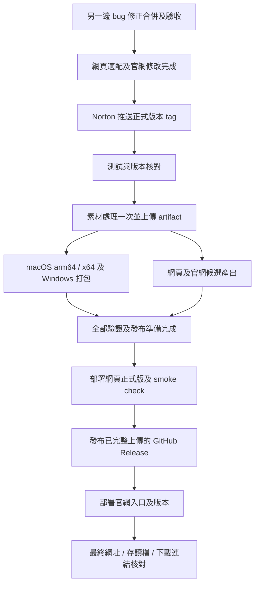

# 香城模擬器：網頁版、可攜存檔及雙平台發布規格

文件版本：1.4（v5.5.0 實作及發布驗收）

日期：2026-11-09（Asia/Taipei）

狀態：Norton 已批准實作及發布 **v5.5.0 —【香城最大模擬器 正式上線！】**，四語主題見第 13.0 節。功能已完成本機實作，正式發布仍須通過統一 CI 及線上驗證；實測結果見 [v5.5.0 驗收記錄](web-release-validation-v5.5.0.md)。

發布基礎：已納入 `ec2839f` 的電車修正及交通追蹤介面；本次接續 `b678485` 的四語版本規劃。保留獨立進行中的 `scripts/metro-train-demo/`，不納入本次發布。

本文件記錄已確認的功能合約及驗收要求。最初文件階段的「只寫規格」限制已由後續「開始發布」授權取代；是否已上線以 GitHub Release、Cloudflare 版本及官網發布記錄為準。

## 1. 產品決定

使用同一個 repository、同一條主要開發分支及同一套遊戲核心，同時維護 Electron 桌面版及瀏覽器網頁版。正式發布由同一個版本 tag 觸發，所有產出使用同一個 commit 及遊戲版本。

| 項目 | 第一版決定 |
|---|---|
| 官方介紹及下載網站 | 保留現有 GitHub Pages，來源為 `docs/` |
| 網頁遊戲 | 部署到 Cloudflare Workers Static Assets，以靜態檔案供應核心遊戲 |
| 城市模擬及畫面 | 在玩家裝置執行 |
| 桌面存檔 | 保留現有 SQLite 及本機 user data 位置 |
| 網頁存檔 | IndexedDB，自動存檔及手動存檔均在玩家瀏覽器 |
| 玩家備份 | 下載單一 `.heungshing` 檔案，兩個平台均可匯入 |
| 帳戶及同步 | 核心遊戲不要求登入；第一版不提供雲端存檔、自動跨裝置同步 |
| 官網遊玩統計 | 官網顯示「累計網頁遊玩人次」；遊戲只傳最小計數事件，沒有 in-game 統計面板 |
| 更新策略 | 舊檔轉換、保留原檔、素材按內容快取、玩家確認後切換執行中版本 |
| 發布策略 | 先完成所有 build 及驗證，再依序發布遊戲、桌面下載及官網入口 |

第一版必須完整做到「瀏覽器遊玩 → 本機 Save → 關閉重開繼續 → 下載備份 → 換裝置匯入」，亦必須做到桌面版與網頁版之間手動搬移同版本城市。

## 2. 現有基礎及需要改動的位置

以下為 2026-11-09 本機檢查結果，實作前須在 bug 修正合併後重新確認。

| 現況 | 位置 | 適配要求 |
|---|---|---|
| Phaser / JavaScript 已在瀏覽器運行 | `index.html`、`main.js`、各模擬及渲染模組 | 共用遊戲核心 |
| 存檔經 REST 寫入本機 SQLite | `save.js`、`server.js`、`db.js` | 抽出儲存介面，新增 IndexedDB 實作 |
| 存檔已有 compact 編碼及版本號；目前為 15 | `save.js` | 共用序列化、驗證及版本轉換 |
| 地圖為 256 × 256 | `main.js` | 網頁版保持同尺寸及相同玩法 |
| 模型 manifest 及清單由 API 提供 | `model-assets.js`、`server.js` | 建置時輸出靜態清單及路徑映射 |
| 天文資料由 SQLite API 提供，來源已在 repo | `astronomy-calendar.js`、`data/hko-astronomy-2026.json` | 建置時輸出相同語意的靜態資料 |
| 校正資料可存在本機資料庫 | `building-lighting.js`、`db.js`、校正工具 | 正式所需設定先匯出為已追蹤的唯讀資料 |
| 部分樓宇貼圖已有按需載入及 GPU 記憶體預算 | `model-assets.js` | 保留機制，另加網絡下載預算 |
| 每 30 秒會隨機載入尚未載入的樓宇 | `rotateZoneTexturePool()` | 網頁版限制下載，避免玩得越久越接近下載完整素材庫 |
| 開場展示城市會載入自己的樓宇及夜景 | `attract-mode.js` | 網頁版首次開場預設使用靜態圖 |
| 開場預載音樂、音效及多類固定建築 | `main.js` `preload()` | 分拆必要素材與延後素材 |
| 桌面 tag workflow 已產出三組安裝包 | `.github/workflows/build-installers.yml` | 延伸為共用 release 流程 |
| 官網另有 main / docs 自動部署 | `.github/workflows/deploy-website.yml` | 加入正式遊戲版本門檻，避免入口過早上線 |
| 官網支援四種語言 | `docs/i18n.js` | `zh-HK`、`zh-TW`、`en`、`ja` 一併更新 |

目前打包模型資料夾約 323.3 MiB／2,439 檔；Music 約 45.7 MiB；Sounds 約 12.9 MiB；UI 約 39.0 MiB。這些是資料夾總量，不是已量度的首次網絡下載量，也不能直接相加當成最終發布包大小。實作須產生實際建置及瀏覽器網絡報告。

## 3. 第一版範圍及功能邊界

### 3.1 必須交付

- 共用城市模擬、建造、交通、鐵路、電車、天氣模擬、節慶及城市內規則生成新聞。
- 網頁的 Save、Save As、Load、刪除存檔、自動存檔及地形編輯器的「我的地圖」。
- 桌面及網頁共用的下載／匯出及匯入城市功能。
- 舊存檔支援清單、版本轉換、轉換前備份及失敗保護。
- 網頁專用素材載入、持久快取及安全切換版本。
- macOS Apple Silicon、macOS Intel、Windows、網頁版的共用 release 流程。
- 官網入口、平台說明、版本資訊、指南及四語文案更新。
- 官網新增累計網頁遊玩人次，與網站瀏覽及桌面下載數分開顯示，計數不依賴登入或上傳城市。

### 3.2 網絡功能的明確取捨

| 功能 | 網頁第一版行為 | 桌面行為 |
|---|---|---|
| 城市天氣、颱風及日夜模擬 | 完整保留，不依賴即時 API | 保持現有功能 |
| 天文曆 | 使用建置內附資料，不在遊戲期間逐日查伺服器 | 保持現有功能 |
| 城市內規則新聞、報紙及事件 | 保留；網絡失敗不影響 | 保持現有功能 |
| 公開論壇、官方新聞、廣告及會員服務 | 第一版透過官網連結開啟；不在遊戲內背景輪詢遠端內容 | 保持現有功能 |
| 即時香港天文台海域報告 | 網頁第一版停用即時請求，顯示「即時海域報告暫未提供」；不把模擬天氣冒充即時資料 | 保持現有功能 |
| Ollama Cloud / AI 新聞 | 網頁第一版不提供 key 設定及付費代理，使用規則新聞 | 保持現有玩家自行設定 key 的功能 |
| 官網遊玩人次 | 成功進入玩家城市並有效遊玩 10 秒後，背景送出一次最小計數事件；遊戲內不顯示數字 | 不新增桌面遙測，不把下載數當遊玩數 |
| 開發校正工具及寫入 API | 不包含在正式網頁操作入口；正式網站不提供這些寫入 route | 維持開發用途，打包版保持適當限制 |

上表屬第一版範圍決定，官網須清楚說明。未來需要內嵌遠端論壇、即時資料或 AI 時，另訂 API、CORS、快取、配額及成本規格，不阻塞本次核心遊戲上線。第一版不需更改現有論壇服務的 origin allowlist。

### 3.3 延後項目

雲端城市資料庫、玩家存檔帳戶、排行榜、多人共同城市、自動同步、存檔分享站、完整手機觸控重新設計及完整離線素材下載包均不屬本次必要交付。遊戲內所有既有核心玩法須保持；網頁載入策略不能改變樓宇機率、經濟參數或解鎖規則。

## 4. 共用程式架構

### 4.1 平台差異集中處理

在現有無框架 JavaScript 結構上加薄的平台介面，不為此重寫成 React、遷移引擎或複製整套遊戲。

| 介面 | 桌面實作 | 網頁實作 |
|---|---|---|
| `SaveStore` | 現有本機 REST → SQLite | IndexedDB |
| `TerrainStore` | 現有本機 REST → SQLite | IndexedDB |
| `AssetCatalog` | 本機 API／打包 manifest | 建置產生的靜態 manifest／清單 |
| `AstronomySource` | 現有來源 | 內附靜態曆 |
| `AppInfo` | 本機 app-info | 內附版本及 build 資料 |
| `PlatformCapabilities` | Electron 全螢幕、更新及 AI 能力 | 瀏覽器全螢幕、下載及網頁更新能力 |

`SaveStore` 須提供列出 metadata、讀取、建立手動槽、覆寫手動槽、寫入專用 autosave、刪除、讀取備份及等待寫入完成等非同步操作；成功回傳須代表資料庫 transaction 已完成。

遊戲核心只呼叫共用介面，不直接以 `fetch('/api/saves')` 決定儲存方式。環境由建置時明確注入 `desktop`／`web`，不以某個 API 的 404 或暫時網絡失敗切換存檔位置。

### 4.2 版本資料

每份產出包含 `gameVersion`、`releaseTheme`、`commitSha`、`assetManifestHash`、`saveDataVersion`、`builtAt`、`platform`。官網發布 metadata 亦須記錄對應版本、網頁 URL 及安裝包下載連結。

遊戲版本、存檔資料版本、匯出檔案格式版本及 IndexedDB schema 版本分開管理。增加建築或修 bug 不應自動增加存檔資料版本。

## 5. 玩家存檔及備份體驗

### 5.1 操作合約

| 操作 | 行為 |
|---|---|
| Save / Ctrl+S | 將目前城市快照寫入目前手動槽；新城市首次 Save 建立手動槽 |
| Save As | 建立新手動槽，成為目前手動槽，原槽保留 |
| 自動存檔 | 沿用獨立 autosave 槽的概念，不覆寫手動槽；清單顯示所屬城市及時間 |
| Load / Ctrl+O | 列出本瀏覽器／本桌面安裝的存檔，不查公開伺服器 |
| 下載存檔 | 由目前城市建立一致快照並產生檔案，包含尚未手動 Save 的進度 |
| 存檔清單「下載」 | 匯出該槽已儲存的資料，不先載入或改變目前城市 |
| 匯入存檔 | 驗證並建立新的手動槽；同名城市亦不覆蓋原槽 |
| 刪除存檔 | 顯示城市名並確認；不影響已下載到裝置的檔案 |

第一版可維持現有「一個專用 autosave 槽」行為，不擴展為每城多份歷史記錄；切換城市時須保持正確關聯，絕不能把甲城快照寫入乙城手動槽。清單文案須讓玩家知道 autosave 會隨目前城市更新。

下載檔案以 `Blob`／瀏覽器下載機制在裝置內產生，匯入透過使用者選取的檔案在裝置內解析。這些操作不發送城市到 Cloudflare，亦不先把檔案上傳再下載。

瀏覽器只代表已接收下載請求，遊戲不能聲稱已確認玩家把檔案寫入硬碟；提示用「已開始下載存檔，請確認瀏覽器下載紀錄」。

### 5.2 提示文案

- 儲存完成：「已儲存到這個瀏覽器。」顯示最後成功儲存時間。
- 備份說明：「存檔保存在這個瀏覽器。下載存檔可自行備份，或搬到另一部裝置繼續。」
- 匯入成功：「已匯入為新存檔：{cityName}。」提供「立即載入」。
- 寫入失敗：「未能儲存，請下載存檔備份。」不能顯示成功圖示或更新成功時間。
- 換瀏覽器／裝置：提示使用匯入；不能承諾同一 Google、Apple 或 GitHub 登入會自動同步。

提示及選單須有 `zh-HK`、`zh-TW`、`en`、`ja` 文案，沿用既有 UI 風格。

## 6. 可攜存檔檔案格式

### 6.1 第一版格式

副檔名為 `.heungshing`，內容為 UTF-8 JSON；MIME 使用 `application/json`。第一版不加 ZIP／壓縮容器依賴，沿用既有 compact 地圖編碼減少大小。

| 外層欄位 | 類型／要求 |
|---|---|
| `format` | 固定 `heung-shing-city-save` |
| `formatVersion` | 整數 `1`，代表可攜檔案容器格式 |
| `gameVersion` | 產生檔案的遊戲版本，作提示及診斷用途 |
| `saveDataVersion` | 與 `payload.save_data.version` 一致 |
| `exportedAt` | UTC ISO 8601 字串 |
| `payload` | 現有 `buildSavePayload()` 的城市資料結構，包含 metadata 及 `save_data` |

建議檔名：`香城_城市名稱_YYYY-MM-DD_HHmm.heungshing`，採玩家裝置本地時間；過濾路徑分隔符、控制字元及作業系統非法字元。

檔案保存城市、地形、建築、交通公司、路線、政策、經濟、遊戲日期、鏡頭、道路組及既有 expansion 狀態。維持遊戲內必要的物件識別碼；移除跨裝置無效的本機存檔槽 ID，例如 `autosave.manualSaveId`。

不包含 SQLite 路徑、IndexedDB row ID、瀏覽器識別碼、AI key、會員／管理員 token、開發機校正狀態或裝置私有設定。城市名稱及玩家輸入的路牌文字屬城市內容，會隨檔案帶走，說明文字須讓玩家知道。

### 6.2 匯入步驟

1. 讀檔前檢查檔案大小。初始上限為 **20 MiB**，兩個平台採相同限制，以容納現有桌面 25 MB 級 REST body 上限的額外欄位；若正式大城 fixture 超過，須同時調整兩端限制及記憶體測試，不能截斷內容。
2. 解析 JSON，檢查 `format`、容器版本及必要欄位；副檔名不作為唯一判斷。
3. 檢查內外存檔版本一致、整數及數值範圍、地圖尺寸、RLE 總長度、稀疏座標、建築／路線參照及可接受字串長度。不得讓小檔案宣告巨量解碼配置。
4. 根據支援清單解碼及轉換；未知版本拒絕匯入，不猜測格式。
5. 顯示城市名、遊戲年份、人口及來源版本。若目前有未存進度，讓玩家先儲存／下載或取消；此時仍未替換目前場景。
6. 成功建立新的手動槽及完成 transaction 後，提供載入；所有本機槽 ID 重新產生。
7. 驗證失敗、取消、超時或儲存空間不足，保留目前城市及所有既有存檔。

桌面原有 `.sqlite` 不屬可攜格式。舊桌面玩家更新後先在遊戲內匯出，再匯入網頁版；網站不讀玩家硬碟上的 SQLite，亦不自動掃描裝置檔案。

## 7. IndexedDB、本機可靠性及多視窗

- 資料庫使用固定名稱，例如 `heung-shing-game`；不能把遊戲版本或 release tag 加入名稱。
- object stores 至少分為 `saves`、`terrains`、`migrationBackups`、`settings`。存檔 metadata 與 payload 可按實作拆表，但必須以 transaction 維持一致。
- 保留現有數字型槽 ID 語意，或在平台層統一轉換；不把桌面槽 ID 直接當網頁槽 ID。
- metadata 記錄 `createdAt`、`updatedAt`、`saveType`、`revision`、城市資訊及資料版本；載入清單不需要逐一解碼完整城市。
- 沿用現有 save queue、城市 session generation 及載入前等待；儲存快照建立時凍結資料，不能在非同步序列化期間混入後續城市變動。
- `revision` 在同一 transaction 比較及增加，過期寫入拒絕覆蓋新資料。
- 同一正式 origin 第一版只容許一個可寫遊戲分頁。其他分頁顯示已有遊戲開啟，可看存檔清單及下載備份，不啟動第二份可寫模擬；關閉／失聯後可重新取得寫入權。優先使用 Web Locks，未支援時以有期限的 IndexedDB lease 配合 BroadcastChannel 通知，不能只用 localStorage 旗標當鎖。
- 自動存檔保留現有事件觸發，另外在遊戲進行且有變動時以最多 60 秒實際時間的間隔安排背景快照；暫停／無變動不反覆寫入。新城市、載入城市及回主選單保持既有正確順序。
- `visibilitychange`／離開前儲存只屬盡力處理，不能把 `beforeunload` 的非同步成功當可靠保證；退出提示以最近成功快照及未儲存變動判斷。
- 首次成功手動 Save 後可呼叫 `navigator.storage.persist()`，結果只作狀態提示，不承諾必然批准。
- 使用 `navigator.storage.estimate()` 觀察總空間；遇到不足先移除可重新下載的素材，再重試一次。不得為了騰空間刪玩家存檔或轉換備份。
- IDB 被封鎖／無法開啟時，清楚提供「只玩並下載備份」模式，暫存於記憶體；不能無聲改用 localStorage 並聲稱已永久儲存。
- 遊戲提供的「清除素材快取」只刪指定 Cache Storage，不刪 IndexedDB。瀏覽器自身清除網站資料或回收 origin 資料仍可能連存檔一起刪除，下載備份不可省略。[瀏覽器儲存政策](https://developer.mozilla.org/en-US/docs/Web/API/Storage_API/Storage_quotas_and_eviction_criteria)
- 不依靠可靠偵測無痕模式；以簡短常駐說明提醒無痕／清除網站資料可能導致本機存檔消失。

## 8. 遊戲更新及存檔相容

### 8.1 支援政策

建立 `supported-save-versions` 清單及實際 fixtures。至少涵蓋目前格式 15、目前正式桌面版實際使用格式，以及本次修改涉及的既有 legacy 格式；最早支援版本須在 release notes 列出，不籠統承諾所有歷史版本。

較新遊戲須能讀取支援清單內較舊存檔。舊遊戲讀到未支援的新格式時提示更新，不嘗試載入、降級或覆寫。遊戲版本不同但資料格式仍相容時，可以正常讀取。

目前 `decodeSaveDataForLoad()` 對較舊版本有直接返回原資料的路徑，不能把它視作所有歷史 compact 格式皆已轉換；新增格式時須按來源版本明確解碼及逐步轉換。

### 8.2 轉換與恢復

1. 將來源原始存檔保存為一份可還原備份，成功後才進行首次持久化轉換。
2. 在副本上驗證及轉換，缺失欄位補既定預設值；更名／移除的模型及功能以明確對照處理。
3. 使用 IDB 或 SQLite transaction 提交結果及版本；失敗時仍可讀／匯出原始檔。備份不足空間時不能覆寫原檔，先要求下載備份或騰出素材空間。
4. 每槽保留最近一次轉換前原檔；重跑同一轉換不能產生無限副本。跨多個格式的更新保留可回到開始來源版本的一份原檔。
5. IndexedDB 結構升級只做必要結構處理；大城市資料轉換於正常啟動後逐槽進行，避免在 `onupgradeneeded` 長時間跑整個素材或場景處理。

更新不能更換正式 origin、資料庫名稱或無條件清空 stores。將來由 `workers.dev` 改自訂域名，須預先通知玩家下載／匯入；不能假設瀏覽器允許跨 origin 直接搬移 IDB。

遊戲回退不等於存檔自動回退。已由新版寫成不相容格式的城市，只能用相容版本或先前原檔備份還原；不能讓回退版強行覆寫。

## 9. 素材建置、按需載入及下載預算

### 9.1 共用來源與可重現產出

- 沿用 `prepare:release-assets` 的 WebP、幾何 metadata、夜景及道路劃線處理，不使用原始大圖直接發布整個工作目錄。
- 素材處理在 CI 執行一次，輸出檔案及雜湊 manifest，透過 artifact 給三組桌面 runner 及網頁 build 使用。
- 下游桌面打包只驗證並使用該份產出，不能再呼叫目前會重新 prepare 的 `dist:mac`／`dist:win` 流程覆寫它；需增加明確的「已備妥素材」打包路徑。
- 若 sharp／平台差異無法共用，先以檔案雜湊及代表性場景比較證明差異，再調整流程；不得同一版本兩端無記錄地使用不同圖像幾何。
- 建置報告列出總檔數、總 bytes、最大檔案、boot 必要素材 bytes、各按需分類大小及缺失參照。

### 9.2 載入優先序

| 優先序 | 素材 | 行為 |
|---|---|---|
| 0 | HTML、CSS、共用核心、版本資料、靜態標題圖 | 先顯示可用選單及進度 |
| 1 | 選定地圖、新城市基本地形、所選道路、必要貼圖 | 足夠開始新城市即可進入 |
| 2 | 載入城市實際引用的建築、交通及當前夜景 | 列出缺少項目並有進度，完成必要項目才替換場景 |
| 3 | 玩家選擇的設施、下一首音樂、即將使用的節慶資產 | 依需要載入，可暫緩及重試 |
| 4 | 純裝飾、開場展示城市及額外變體 | 不阻塞遊玩，不預設下載完整資料庫 |

網頁首次開場使用靜態背景，不為展示城市下載一套大型城市；即時背景作可選功能，明示需要額外下載。桌面預設保持現有開場體驗。

音樂待玩家互動及啟用後逐首下載，音效依事件載入；不能在主選單預先解碼整個音樂庫。瀏覽器 autoplay 被拒絕時保持可玩，不顯示載入失敗。

樓宇生長先依原本權重選模型，再排隊載入所需貼圖；未載入時以暫時視覺代替，不能永久變成另一類樓宇或令 H／UH 區缺少原有模型。固定設施可先載入工具圖示，選取及放置時準備貼圖。

背景素材預抓預設關閉；之後如開放，整個 session 額外預抓預算初值 5 MiB，遇到 `saveData`、離線或可辨識慢速連線即停止。網絡資訊 API 不可用時採保守預設。GPU 的 192 MiB 貼圖預算與網絡下載預算分開計。

### 9.3 上線效能目標

以下均為待量度的目標，不代表現版已達成。

| 指標 | 驗收目標及量度方法 |
|---|---|
| 冷啟動新城市 | 到可建造時，實際傳輸量目標不超過 40 MiB；若超過，先調整預載或明確記錄接受的預算 |
| 主選單 | 定義 20 Mbps、100 ms RTT 的測試設定後，目標 5 秒內可操作 |
| 新城市可玩 | 同設定、正常桌面 GPU 目標 25 秒內可建造；記錄解析及 GPU 上傳時間 |
| 暖啟動 | 內容未變的已快取圖片／音樂不重傳 body；小型版本檢查可發生 |
| 載入大城市 | 只補齊該城市缺少的素材，有進度、取消及重試；不承諾同新城一樣的下載量 |
| 連續遊玩 | 靜止城市額外背景下載不能無上限增加；任何素材輪換遵守預算 |
| 存檔／下載備份 | network log 中不得出現城市 payload 的遠端上傳或下載 |

20 Mbps 下單純傳輸 40 MiB 已需約 17 秒，不能同時承諾「40 MiB 全載入且數秒內可玩」。測試報告須分開主選單可操作、新城市可玩及大城市載入。

網頁啟動不依賴第三方 CDN 上的 Phaser：發布包內附目前已驗證版本及其授權文字，與遊戲核心一起快取。初版優先保留目前版本，不把網頁適配與引擎升級綁在同一 release。

## 10. 網頁快取、更新及有限離線能力

### 10.1 檔案命名及快取

| 類別 | 策略 |
|---|---|
| 穩定入口 HTML、release metadata、service worker | 重新驗證／network-first，離線回退到已完整快取的版本 |
| JS、CSS、模型、音樂、唯讀資料 | 以輸出內容 hash 定址，長快取 `public, max-age=31536000, immutable` |
| 玩家城市及地圖 | 只在 IDB，不作 HTTP 或 Cache Storage response |
| 外部論壇／會員頁 | 在官網開啟，不納入遊戲 service worker |

現有 manifest 的逐素材 hash 可作起點；網頁需確保 URL 指向不可變的檔案內容。不能在相同路徑持續替換 body，卻宣告永久 immutable；只加不同 query 亦不能解決舊分頁在 CDN cache miss 時拿錯新內容的問題。

新增 hash 檔名或不可變素材路徑；建築在存檔中的穩定 logical ID 與下載檔名分開。未改內容的素材 URL 跨 release 保持相同；修改夜景 bake 時，其 hash 亦必須反映實際輸出內容。

保留目前版本及最近 30 日內發布過的各版本所需程式與素材；即使上一個正式版本較舊，仍至少保留目前及上一版。多次密集發布不能令仍在保留期的版本失去素材。更早的分頁如要求已刪素材，顯示「請下載進度並更新遊戲」，不能悄悄用同名新圖代替。素材依 hash 去重，保留時須遵守 host 檔數上限。

### 10.2 Service worker

- 只快取最小可啟動集合及實際成功下載的素材，不在 install 階段下載完整 323 MiB 模型庫。
- 程式 shell 依 build 分版本；素材 cache 依內容 hash 跨版本重用。
- 新 service worker 準備好後提示「有新版本」，不在玩家建造中強制 `skipWaiting` 或 reload。
- 玩家選擇更新時先確認所有可寫分頁狀態；完成儲存或下載進度、停止模擬後，才切換及重新載入。不能由一個分頁的更新操作令另一分頁失去尚未保存的狀態。
- 只清理本遊戲可刪除的 cache；不調用刪除存檔資料庫，不以清 IDB 修復素材版本。
- 素材快取設軟上限 200 MiB，並按可用空間下調；接近上限時以 LRU 刪除非必要素材。快取被拒絕時允許直接下載及遊玩，但提示不能保證下次重用。
- 載入失敗重試有上限，保留錯誤及重試 UI，不能永久顯示 loading。

已載入並快取完整必要集合的城市，可在斷網後繼續當前遊玩及本機存檔。重開離線可用性只承諾已快取的 shell／城市素材；遇到未下載建築或新節慶須提示需連線，不宣稱整個遊戲完整離線。[Service worker 更新生命週期](https://developer.mozilla.org/en-US/docs/Web/API/Service_Worker_API/Using_Service_Workers)

音訊播放及全檔下載須在 Safari 實測。Workers Static Assets 目前對 Range 請求回傳完整檔案；第一版採短檔完整下載後播放，不以必須支援 byte-range 的串流播放器作唯一播放路徑，也不為每首音樂加動態代理。[Range 行為](https://developers.cloudflare.com/workers/static-assets/billing-and-limitations/)

## 11. Cloudflare 部署及成本邊界

### 11.1 部署方式

建立專用正式網頁遊戲項目，使用 Workers Static Assets 直接供應產出資料夾；核心遊戲無城市資料庫、無伺服器 session、無 SSR。缺失資產須回 404，不能一律回 `index.html` 導致圖片／JSON 被當 HTML。

正式 origin 在第一批玩家儲存之前定案。若暫用 `workers.dev`，後續沿用同一正式項目 hostname；預覽項目與正式項目分開，預覽存檔不會自動出現在正式網址。是否選購自訂域名由 Norton 決定，不阻塞以固定免費網址上線。

GitHub Actions 作唯一正式發布入口；Cloudflare Git integration 如有開啟，只用於明確的預覽流程，不能另行在 main push 時跳過桌面驗證而發布正式遊戲。Cloudflare 官網用於項目、域名、用量、部署狀態及回退管理。

### 11.2 成本原則

按 2026-11-09 查閱的官方資料，Workers Static Assets 的靜態請求免費且不限次數，素材儲存無額外費用；執行 Worker 程式另依其方案計算。因此本規格將核心遊戲設計為直接靜態服務，目標是該部分 hosting 為 $0／月。第 12 節新增的官網計數使用小型動態服務，須獨立估算，不能視作免費無限靜態請求。[官方收費規則](https://developers.cloudflare.com/workers/static-assets/billing-and-limitations/)

- 不為圖片、音樂、Save、Load 或匯出加 `run_worker_first`／動態中轉。
- 第一版不新增城市上傳儲存、R2、KV 或 AI 代理。唯一新增的動態資料用途為官網遊玩計數，可用專用 Worker 及小型 D1；不把城市、存檔或玩家身份放入統計資料庫。現有官網論壇的服務費另計，不能把「核心遊戲免費」說成整個帳戶所有服務永遠免費。
- 自訂域名、GitHub CI／artifact 用量及未來動態功能屬分開成本，發布前列明是否已有付費方案。
- 不建立有超額計費的服務以繞過限制；如需要，先提出具體用量及可檢查方案再決定。
- 素材壓縮、瀏覽器快取及 CDN 分發分別量度；CDN cache 命中仍會向玩家傳輸 body，瀏覽器本機命中才避免該次重傳。

### 11.3 上傳限制及發布檢查

目前 Workers 免費方案為每版本最多 20,000 個靜態檔案、每檔最多 25 MiB。CI 須對最終產出連同保留版本計數及檢查大小，超出即失敗，不部署不完整版本。[官方限制](https://developers.cloudflare.com/workers/platform/limits/)

現有約 2,439 個模型檔符合上述單項條件，但最終網站仍須連同音樂、程式、保留資產及 metadata 整體計算。CLI／CI 部署，不採用有較低檔數限制的 Pages 官網拖放上傳。對安裝包及官網影片沿用現有下載網站的供應方式，不複製進網頁遊戲部署包。

## 12. 官方網站更新規格

保留目前 `https://nortonyuen-oss.github.io/heung_shing_simulator/` 的網站、品牌、圖片、影片、指南及社群入口。此次為功能及文案更新，不另做整站視覺重設。

| 位置 | 更新內容 |
|---|---|
| 導覽及首頁主操作 | 新增「即刻玩／Play in Browser」，保留免費下載及指南 |
| 平台標示 | 列出「瀏覽器、macOS、Windows」，標示網頁第一版／Beta 如仍屬試行 |
| 網頁版介紹 | 無需安裝、核心遊戲無需登入、城市在本機瀏覽器、可下載及匯入存檔 |
| 存檔指南／FAQ | Save 與下載備份的分別、換機方法、清網站資料／無痕風險、桌面轉移流程 |
| 版本及 changelog | 同 tag 的遊戲版本、主題、bug 修正、網頁功能及已知限制 |
| 系統要求 | 網頁以桌面瀏覽器、滑鼠及鍵盤為第一版支援目標；不先承諾手機已完整適配 |
| 下載區 | 保持 macOS 兩架構、Windows 安裝及 portable 連結與 updater 檔名規則 |
| 現有 `#stats` 統計區 | 新增「累計網頁遊玩人次」，與「總下載次數」「入口瀏覽」分開；統計只在官網顯示 |
| 網絡功能說明 | 列出 AI、即時海域報告及遠端論壇在網頁首版的行為 |
| 版權／私隱說明 | 說明城市不自動上傳、下載檔包含城市自訂內容，以及最小遊玩計數事件及保留期；保留現有授權及來源標示 |

所有新文案及按鈕四語齊備，鍵盤可操作，有清楚 label。官網不預抓網頁遊戲的完整素材；玩家點擊「即刻玩」後才載入遊戲。

官網使用 release workflow 產生的已發布 metadata 更新版本及 Play URL。現有 `docs/site.js` 以 GitHub Releases 顯示下載統計的功能可保留，但主要 Play／下載連結不依賴即時 GitHub API 成功；API 失敗或限流時使用已發布的靜態 metadata。

發布記錄以同一 GitHub Release 附加的 `release-manifest.json` 為準，記錄 tag、commit、網頁部署識別碼、正式 Play URL、素材 hash、存檔資料版本、首版功能差異及桌面下載檔名。網頁檢查成功後在 draft 階段寫入該 manifest，再正式發布；官網把相同資料產生為靜態檔。後續獨立官網文案部署在建置時讀取已正式發布且通過驗證的 manifest，不能使用 main 上未發布的 `package.json` 版本冒充最新版。這個讀取發生在 CI，無需每位訪客查詢 GitHub API。

首次上線前，「即刻玩」不顯示為可用正式入口。後續更新若新遊戲部署失敗，官網繼續連上一個成功正式版本。不能把預覽網址、未準備好的 URL 或假的新版成功標記先發布出去。

### 12.1 官網遊玩統計的顯示

在現有首頁 `#stats` 加入一項「累計網頁遊玩人次／Web Play Sessions」，顯示累計值、統計開始日期及最後更新時間；四語齊備，格式依目前官網語言呈現。數字可延遲約 5 分鐘，不提供即時在線人數或遊戲內統計面板。

保留並區分現有三類資料：GitHub Release 下載數是下載次數，現有 hits.sh badge 是官網入口瀏覽，新增數字是網頁實際開始遊玩的 session。不能將三者相加、以 Play 按鈕點擊代替遊玩，或將下載／瀏覽人次標成獨立玩家人數。

官網附簡短定義：「正式網頁版開始遊玩的累計人次，並非獨立玩家數；離線或封鎖統計可能未計入。」桌面版實際遊玩不在此數字內，也不因此新增桌面遙測。詳細定義放 FAQ，遊戲畫面不增加數字或統計提示。

### 12.2 一次遊玩人次的定義及排除

- 只在正式發布的網頁 origin，玩家選擇新城市、載入或匯入自己的城市，場景可操作並累積 **10 秒前景有效遊玩**後，產生一次 `play_start`；這是實際時間，不是模擬年份／月份。
- 單純開啟遊戲標題頁、觀看展示城市、點擊官網 Play 但載入失敗、使用地形編輯器，均不計數。
- 同一分頁的瀏覽器 session 使用 `sessionStorage` 的隨機事件 ID 及已記錄狀態；重新整理、切換城市、Save／Load、轉換語言及同一分頁升級遊戲不重複增加。關閉後重新開始、另一裝置或新的獨立分頁可以計為另一次人次；這不是跨裝置去重人數。
- 複製分頁、瀏覽器還原 session、封鎖儲存等行為可能影響估算；不使用持久身份、指紋或 IP 來追求「獨立自然人」精確值。sessionStorage 不可用時只在記憶體去重，明列重新整理可能重計的限制。
- localhost、CI、預覽 origin、測試環境及正式 smoke test 必須停用事件；正式 smoke test 使用由測試設定注入的停計能力，不能把公開 query 參數當服務端驗證憑證。
- 事件 ID 必須在請求前保存，逾時重試使用同一 ID。服務端在去重保留期內對同一 ID 只增加一次，不能只靠前端旗標防止重複。
- 第一次未連線或請求失敗，可在目前分頁 session 內重試一次；不做長期離線佇列、不定時 heartbeat，也不因計數失敗阻止城市載入或儲存。

### 12.3 最小計數服務

採用獨立 `services/statistics/` Worker 與專用小型 D1，避免改動論壇登入及內容資料；核心遊戲素材仍直接走 Static Assets，不經統計 Worker。標準 Cloudflare Web Analytics 目前未支援自訂事件，不能只開頁面分析就聲稱已有「實際開始遊玩」計數。[官方事件能力說明](https://developers.cloudflare.com/web-analytics/faq/)

| 介面／資料 | 合約 |
|---|---|
| `POST /v1/play` | 只收固定 `play_start`、隨機 `eventId`、正式 `gameVersion`；小型 JSON，body 上限 1 KiB |
| `GET /v1/stats` | 只回公開累計 `webPlaySessions`、`since`、`updatedAt` 及統計狀態，無事件明細 |
| `play_events` | 只存事件 ID 的 hash、伺服器接收時間及遊戲版本，唯一鍵去重；30 日後分批清除 |
| `play_totals`／每日彙總 | 原子累加累計及伺服器 UTC 日期彙總，保留總數及每日計數；清除事件去重資料不減少累計 |

唯一事件寫入與總數增加必須在同一原子操作／transaction 中完成；重送及並行不能雙計，也不能因中途失敗留下有事件但沒計數的半套狀態。遷移、部署及版本回退都不重設累計；去重資料保留期內的重送必須通過驗收。

只接受明確允許的正式遊戲 origin 寫入，官網 origin 只讀公開彙總；檢查方法、格式及正式版本，配合邊緣限流排除明顯濫用。Origin 可被非瀏覽器客戶端偽造，不能宣稱此數字是防作弊、經審核的精確人數。

不傳送或在統計資料庫保存城市名稱、地圖、人口、預算、存檔內容、帳戶、會員 token、AI key、原始 IP 或完整 User-Agent。不把事件 ID 寫入城市存檔或匯出檔；不使用跨網站追蹤 cookie。平台基本請求日誌依帳戶設定處理，不能把應用資料最小化說成 host 完全沒有請求日誌。

### 12.4 成本、快取及失敗處理

- 每次合資格 session 最多一次成功計數，最多額外重試一次；不在每個模擬 tick、每次 Save 或每分鐘上報。
- 官網每次載入最多讀一次統計，服務端快取彙總 5 分鐘、瀏覽器可短暫快取；不輪詢即時在線數，不對原始事件做每次全表 `COUNT(*)`。
- 第一版使用免費方案能力，初始業務上限為伺服器 UTC 每日最多接受 5,000 次新計數，達上限停止計數而不中斷遊戲；請求、讀寫及清理均須限流及量度，成功人次上限不能單獨當成抵擋任意請求洪水的成本保證。
- D1 目前免費方案每日 500 萬 rows read、10 萬 rows written，帳戶超額會拒絕查詢；寫入 index 及刪除亦有用量。發布前須連同現有論壇及其他服務估算，專用資料庫不代表帳戶額度完全隔離。若帳戶已是付費方案，先核對實際計價及上限，不自動開啟付費擴容。[D1 計價及免費上限](https://developers.cloudflare.com/d1/platform/pricing/)
- 規模超過免費額度時容許漏計並標示統計受限，不為保住數字強制付費，也不影響玩家存檔。不能保證任意流量下所有統計服務永遠免費。
- 官網讀取失敗時顯示上次成功數字及時間，並標示「暫未更新」；沒有可信快取時顯示「暫未提供」，不能以假 `0` 取代。成功取得真實 `0` 可正常顯示。
- 停計或服務故障期間的資料不能自行估算補回；記錄受限／中斷狀態，FAQ 說明數字是已記錄的人次估算。

### 12.5 發布整合

首次開放 Play 入口前先部署統計 schema／服務、正式 origin allowlist 及唯讀彙總介面，再驗證正式遊戲的事件接駁。統計功能須於候選版本驗收，但 runtime 停機不能成為玩家遊玩的硬依賴。

網頁建置設定加入公開的統計 URL／啟用旗標，官網設定加入唯讀統計 URL；皆不包含管理 key。預覽及 CI 預設停計。後續 release 只做必要的向前相容遷移，不因新版、重試部署或回退清空計數；更新官網時保留可讀上一版彙總的能力。

## 13. CI/CD 與正式 release 次序

### 13.0 版本建議及主題命名

| 欄位 | 發行規劃 |
|---|---|
| 目前本機遊戲版本 | `v5.4.0` |
| 本次功能完成後的建議版本 | **`v5.5.0`** |
| 版本類型 | minor：新增網頁平台、可攜存檔及官網遊玩統計，維持既有存檔相容 |
| 廣東話／`zh-HK`／預設 `releaseTheme` | **【香城最大模擬器 正式上線！】** |
| 台灣中文／`zh-TW` | **【線上遊玩開通】** |
| English／`en` | **【Heung Shing's Biggest Simulator — Now Online!】** |
| 日本語／`ja` | **【香城最大のシミュレーター、オンラインで正式公開！】** |
| 目前提交範圍 | 本規格及發行規劃；不代表網頁功能已實作 |

廣東話及台灣中文名稱由 Norton 指定，原文保留；英文及日文依其要求翻譯。正式套用時，`package.json` 的 `releaseTheme` 使用廣東話名稱，`releaseThemes` 的四個語言鍵、遊戲顯示、官網及 release notes 使用本表相同文字與標點。此處「正式上線」屬未來版本主題，不代表目前已部署。

版本判斷沿用 `README.md` 的規則：修 bug 為 patch、新玩法／內容功能為 minor、不相容的存檔變更為 major。本次以保留舊檔相容為必要條件，所以建議由 `5.4.0` 升至 `5.5.0`；若先獨立發布目前的電車修正而未包含網頁功能，可另以 `5.4.x` patch 處理，實際號碼以當時最新版本為準。

本次先提交規格 checkpoint，不修改 `package.json`、lockfile、正式 release notes 或官網的現行版本，不建立 `v5.5.0` tag。功能實作與驗收完成後，再依 [release checklist](release-update-checklist.md) 統一套用本節已定的四語主題、遊戲及安裝包版本與官網文案，最後由 Norton 決定發布時點。

### 13.1 觸發規則

| 事件 | 工作 | 可否改正式環境 |
|---|---|---|
| PR / 一般 commit | 相關測試、網頁建置及必要的隔離預覽 | 否 |
| main 合併 | 持續驗證；不自動啟動本次雙平台正式 release | 否，獨立文件修正按下述規則 |
| 正式版本 tag `v<version>` | 全套準備、三組桌面、網頁及官網產出與驗證 | 驗證成功才發布 |
| 手動重試指定 tag | 使用同 commit、同 artifact／雜湊重試失敗步驟 | 可以恢復該次發布，不任取最新 main |

`v5.5.0` 為本文件的建議目標；正式版本仍須由 Norton 在 bug 修正及本規格實作完成後確定。tag 必須與 `package.json`、release theme、release notes 及官網資料一致，否則 CI 失敗。

### 13.2 共用管線

使用 job dependencies 管理門檻，artifact 在 runner 之間傳遞同一份素材及產出。[GitHub Actions artifact 機制](https://docs.github.com/en/actions/tutorials/store-and-share-data)

必要 jobs 的責任：

1. `validate`：版本、現有測試、存檔 fixtures、匯入界限及 release notes 核對。
2. `prepare-assets`：執行既有素材流程及驗證，產出 hash、大小、缺失參照報告。
3. `build-desktop`：沿用三個平台目標及安裝包／blockmap／`latest.yml` 規則。
4. `build-web`：產生靜態包、唯讀資料、vendor、快取設定及 release metadata。
5. `verify-web`：以無 Node 遊戲 API 的靜態 server 測試，冷／暖啟動、存讀檔、匯出匯入、離線降級及效能預算。
6. `prepare-release`：建立 draft GitHub Release，所有安裝包及 metadata 齊備才進下一步；必要的 Cloudflare、GitHub Pages 及 repository 權限亦先核對；首次發布先驗證官網計數 schema、服務及 origin 設定，後續遷移不重設總數。
7. `deploy-web`：部署該次候選產出，檢查回傳版本、hash、資產及基本遊戲行為；失敗停止發布並恢復上版。
8. `publish-release`：將完整 draft 設為正式發布；保留 Windows updater 已有下載命名及連結規則，不把 draft 先當成 latest。
9. `deploy-official-site`：只在網頁及 GitHub Release 成功後部署對應官網 artifact，避免重抓最新 main 混入其他改動。
10. `verify-release`：檢查三個正式入口，輸出 release URL、Play URL、官網 URL、commit 及產出 hash。

跨 Cloudflare、GitHub Releases 及 GitHub Pages 並非原子交易，不能保證同一秒上線。上面採依序發布及補償恢復，遇到部分失敗須清楚標示狀態，不能只因某個 job 成功就報整個 release 完成。

### 13.3 現有 workflow 的調整

- `.github/workflows/build-installers.yml` 延伸為統一 release workflow，或抽出可重用 jobs；不複製成兩套各自決定正式版本的 pipeline。
- `.github/workflows/deploy-website.yml` 保留獨立網站文案修正用途，但涉及 Play URL、版本、下載及可用狀態時須經 release metadata 門檻。
- 發布時產生的官網 metadata 不 commit 回 main 觸發循環建置；部署 artifact 與後續原始碼 build 都須讀取已確認的發布記錄，不能讓普通 docs 部署蓋回舊版本或預覽 URL。
- 正式環境使用 repository 層級的發布鎖／明確 concurrency 政策，官網獨立部署與 release 部署不得同時互相覆寫；已開始正式發布的 run 不因新 commit 被隨意取消。
- artifact 設合理保存期，例如一般 PR 7 日、正式候選 30 日；正式已發布包保留於 GitHub Release，避免 CI 儲存無限累積。實際保留期依帳戶方案核對。
- Cloudflare token 存 GitHub Secrets，account ID／項目名／Play URL 放適當設定；token 不進 repo、前端、存檔或 log。網站建置只採明確公開檔案 allowlist，不能把 `.data`、SQLite、`.dev.vars`、Git 資料或來源工作目錄整包上傳。

### 13.4 重試及回退

| 失敗位置 | 處理 |
|---|---|
| 測試／任一 build 失敗 | 正式三個入口維持原版 |
| 網頁部署或 smoke check 失敗 | 維持／回復前次 Cloudflare 部署，GitHub Release 保持 draft，官網不動 |
| 網頁已成功，GitHub Release 發布失敗 | 優先以同產出重試；若本次發布取消，回復網頁，不刪玩家存檔 |
| 遊戲與 Release 成功，官網部署失敗 | 保留可用遊戲及 Release，舊官網仍有效；以同 tag 官網 artifact 重試 |
| 上線後發現資料相容 bug | 停止升級提示，保留所有存檔及備份，回退前先檢查舊版是否能讀現有格式；提供修復版本或原檔恢復指引 |

## 14. 預計檔案及指令交付

以下命名為實作建議，容許按現有結構調整，但責任及驗收行為不可省略。

| 交付 | 內容 |
|---|---|
| 儲存介面及兩個平台實作 | 將 `save.js` 直接 REST 操作集中，保留既有 queue／session 保護 |
| 可攜檔案模組 | 下載、解析、驗證、轉換及匯入；兩邊共用 |
| 版本轉換及 fixtures | 有明確來源版本、預期內容及不可變原檔 |
| `scripts/build-web.js` | 以 allowlist 產生 `release/web/`，輸出清單、資料、hash 及報告 |
| `scripts/verify-web-build.js` | 檔案大小、檔數、素材參照、禁止內容及版本一致性檢查 |
| `wrangler.web.jsonc` | 獨立遊戲靜態部署設定，指向 `release/web/`，不沿用論壇服務設定 |
| service worker 及 web manifest | 最小 shell、runtime cache、更新提示及 cache 預算；安裝為 PWA 非必要 |
| `package.json` scripts | 新增 `build:web`、`verify:web`、`preview:web` 及可重用素材的桌面打包路徑 |
| Electron 排除規則 | 排除 `release/web/`、建置報告等網頁產出，防止桌面包內再嵌一份網站 |
| 官網 `docs/` 修改 | Play 入口、FAQ／指南、四語及已發布 metadata 回退 |
| `services/statistics/` 及官網統計接駁 | 最小事件、去重、累計彙總、唯讀 API、免費額度與失敗回退；遊戲只含背景事件，不加統計面板 |
| CI workflow、README、release notes | 同 tag 發布、必要帳戶設定、測試及恢復說明 |

`release/` 已在 `.gitignore`，網頁輸出可放其下，不把 300 MiB 級建置結果 commit 入原始碼。相同素材的共享 artifact、網頁內容位址及桌面 bundled 路徑由 manifest 映射，不改存檔中的 logical ID。

## 15. 支援平台及驗收條件

### 15.1 瀏覽器與桌面範圍

網頁第一版以正式發布時仍受支援的桌面 Chrome、Edge、Firefox、Safari 為目標，驗收報告記錄實測 OS／瀏覽器版本，不能以 Playwright WebKit 通過取代真實 Safari 的下載、音訊及儲存驗收。手機／平板做啟動及提示檢查，不先列為完整操控保證。

桌面繼續支援目前 Windows、macOS Intel 及 Apple Silicon 產出。既有 macOS 簽名／自動更新限制保持如實說明，本次不另承諾已解決簽名及自動安裝。

### 15.2 必須通過的驗收表

| ID | 情境 | 成功條件 |
|---|---|---|
| S01 | 網頁新城 Save，關閉後重開 | 同一 origin／瀏覽器可繼續，核心狀態一致 |
| S02 | 多個手動存檔與 Save As | 槽位正確，原城不被誤覆寫 |
| S03 | autosave、快速切城、刪原手動槽 | 沒有跨城市誤寫，刪槽後不按同名誤連另一城 |
| S04 | 未手動 Save 即下載 | 檔案包含下載當刻的完整一致快照 |
| S05 | 桌面匯出 → 網頁匯入 | 地形、建築、政策、交通線、預算、日期及鏡頭一致 |
| S06 | 網頁匯出 → 桌面匯入 | 同版本／相容資料格式可繼續遊玩 |
| S07 | 同名檔重複匯入 | 新增槽，不覆蓋原槽或錯連 autosave |
| S08 | 無效、截斷、過大、未知／未來版本 | 明確拒絕，原城市及既有檔案不變 |
| S09 | 支援的舊格式及缺欄位 | 先備份再轉換，資料符合 fixture；失敗能匯出原檔 |
| S10 | IDB 不可用、quota 滿、transaction abort | 不顯示假成功，可下載目前城市，清素材不刪存檔 |
| S11 | 第二個分頁／舊分頁重取寫入權 | 不會由兩個分頁同時覆寫，過期 revision 被拒絕 |
| U01 | 相同 origin 部署新版 | 原存檔仍可列出及載入 |
| U02 | 遊玩期間準備好新 service worker | 先提示，沒有強制 reload 或混用新舊 JS |
| U03 | 相同素材跨版本 | 內容不變的 URL 保持一致，暖啟動不重傳 body |
| U04 | 舊分頁在新版發布後請求素材 | 仍取得對應版本；超保留期有可保存進度的更新提示 |
| L01 | 冷／暖啟動及載入大城市 | 按第 9 節產生可重現網絡及時間報告 |
| L02 | 首頁停留及靜止城市 30 分鐘 | 不下載完整音樂庫／展示城市／無限樓宇變體 |
| L03 | 斷網、資產 404、慢速／失敗下載 | 存檔仍可處理；進度能結束／重試，不永久 loading |
| L04 | 日／夜、鐵路／電車、節慶及大型設施 | 核心玩法與桌面一致，沒有因 lazy load 改變生成機率 |
| L05 | Safari 音訊、下載／匯入及持久儲存 | 真實 Safari 驗證結果有記錄 |
| N01 | 純靜態服務，移除所有 Node 遊戲 API | 新城、存讀檔、地形及天文仍正常；沒有必要 API 404 |
| N02 | network log 檢查 | 城市快照、下載存檔及 key 不發送到遠端 |
| C01 | 任一桌面 build 或網頁檢查失敗 | 正式 Release、Play URL、官網可用標記不提前更新 |
| C02 | 三端版本與 hash 核對 | 來自相同 tag／commit，共用素材產出及存檔版本 |
| W01 | 官網四語、Play、下載及指南 | 連結可用，版本一致，瀏覽器資料清除限制說明齊全 |
| W02 | GitHub API 限流／離線 | 主要 Play 及下載連結仍可由靜態 metadata 使用 |
| T01 | 正式城市前景遊玩達 10 秒 | 官網累計最終增加 1；標題頁、展示城市、編輯器、預覽及 smoke test 均不計 |
| T02 | 同分頁重新整理、切城及請求重送／並行 | 同一 session／去重保留期內的事件只計一次，原子寫入沒有半套狀態 |
| T03 | 官網顯示與服務失敗 | 只有官網有四語統計，三類指標分開；可信舊值標示暫未更新，無舊值不顯示假 0 |
| T04 | 限流、每日業務上限及免費額度不足 | 停計不阻塞遊玩或存讀檔，不無限重試或自動啟用付費擴容；部署不重設累計 |
| T05 | 統計資料及網絡檢查 | 事件不帶城市／存檔／身份／key，無 heartbeat；官網讀彙總不觸發增加，事件明細不能公開查詢 |
| R01 | 回退與失敗重試演練 | 原存檔保留，只有指定 tag 產出被重試，官網不指向壞部署 |

優先重用既有 Node 測試及 fixtures，新增有實際資料往返、跨版本及失敗行為的測試；不以檢查某段原始碼字串存在當作功能驗收。純文件階段不執行遊戲測試或重新產生素材。

## 16. 實作順序及與另一邊 bug 修正的交接

| 階段 | 工作及交付 | 門檻 |
|---|---|---|
| 0：現在 | 保存本規格，保留目前其他工作中的修改 | 只文件，不 release |
| 1：修正合併 | 確認另一邊 bug 修正已合併、無回歸，記錄 base commit | Norton 確認該修正可納入 |
| 2：存檔共用 | 儲存介面、IDB、匯出／匯入、舊檔備份及相容測試 | S 系列核心條件通過 |
| 3：靜態適配 | 模型、天文、app-info、校正資料、網絡功能能力開關 | 無遊戲 Node API 亦可玩 |
| 4：載入及更新 | lazy load、內容定址、service worker、quota、效能報告 | L／U 系列通過 |
| 5：CI／官網 | 共用素材及發布門檻、四語入口、遊玩計數、帳戶設定、隔離預覽 | C／W／T 系列及 preview 驗收 |
| 6：候選版本 | 真實桌面平台與 Safari 驗證、備份及回退演練 | 所有必要驗收完成 |
| 7：正式發布 | Norton 決定版本並推送 tag，執行第 13 節 | 官網最後開放新入口 |

不要在本機其他工作未完成時 reset／stash／覆蓋其修改；此規格撰寫時 `i18n.js`、`index.html`、`traffic-visuals.js`、`tram-lines.js`、`tram.js` 及 `scripts/metro-train-demo/` 有其他進行中變更，僅作交接提示，不代表該 bug 的正式範圍。

## 17. 正式上線前的待定設定

以下是外部設定及發行資料，不阻止先完成本地實作，但正式發布前必須有實值：

- 另一邊 bug 修正的 commit／PR 及驗收記錄。
- 最終遊戲版本號、依第 13.0 節四語主題整理的 release notes，以及 tag commit。
- Cloudflare 正式項目名稱、穩定 Play URL、預覽項目與 GitHub Actions 的部署授權。
- GitHub Pages 發布權限及新版 workflow 的正式環境設定。
- 是否使用自訂域名；若使用，必須在首次正式玩家存檔前設定。
- 最早支援存檔版本及真實大城市 fixtures；未取得前不承諾任意歷史檔都可讀。
- 實測瀏覽器／機器、首次下載預算結果及已知限制。
- Cloudflare、GitHub CI／artifact 及現有論壇服務的帳戶方案；發布當日再核對價格及限制。
- 官網統計服務 URL、D1／Worker 免費額度與帳戶共用預算、正式 origin、開始統計日期及停計狀態管理。

帳戶登入及首次服務授權如需 Norton 操作，只在已準備好具體設定及可驗證產出後交接；不要求把 API token、密碼或私人 key 貼入聊天。

## 18. 完成定義

只有在以下事項全部成立，才可報告本次網頁發布完成：

1. 指定 bug 修正及本規格的必要功能已合併，兩平台共用核心正常。
2. 玩家可在正式網頁建立、儲存、重開、下載及匯入自己的城市，兩平台可攜檔往返通過。
3. 正式核心遊戲由靜態檔供應，玩家城市不經 hosting 傳輸，下載及快取報告符合接受的預算。
4. 相同 tag 的三組桌面安裝包、網頁及官網成功發布，版本、素材與存檔支援資訊一致。
5. 官方網站四語入口、備份指南、下載連結、首版差異及累計網頁遊玩人次清楚可用；統計定義、開始日期及失敗顯示通過驗收，遊戲內沒有統計面板。
6. 新版更新、儲存失敗及回退有經驗證的保護與操作說明。
7. 交付正式 Play URL、官網 URL、GitHub Release URL、commit、測試結果及已知限制；未通過的必要項目不能以「之後再補」標記為完成。
